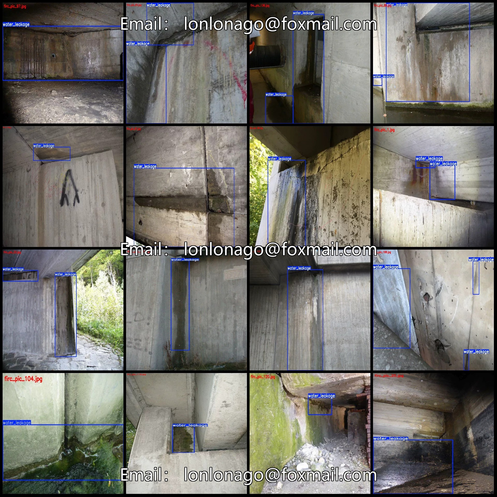
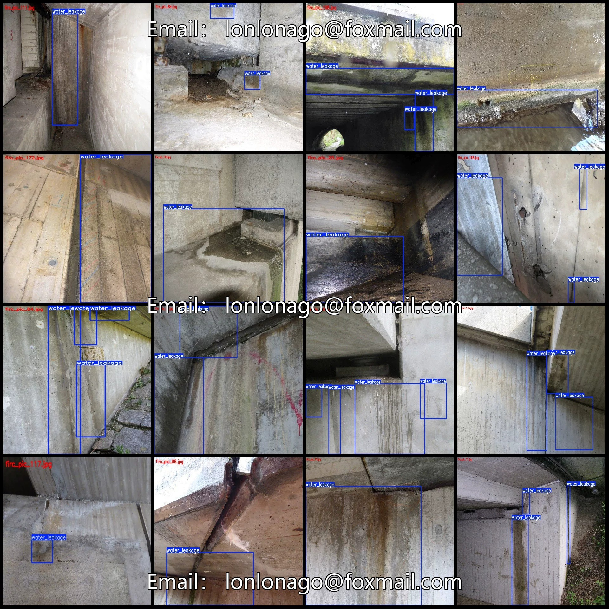
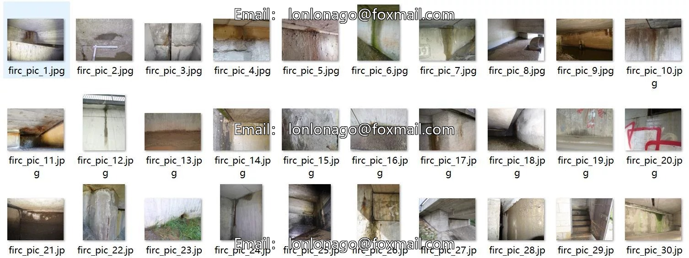
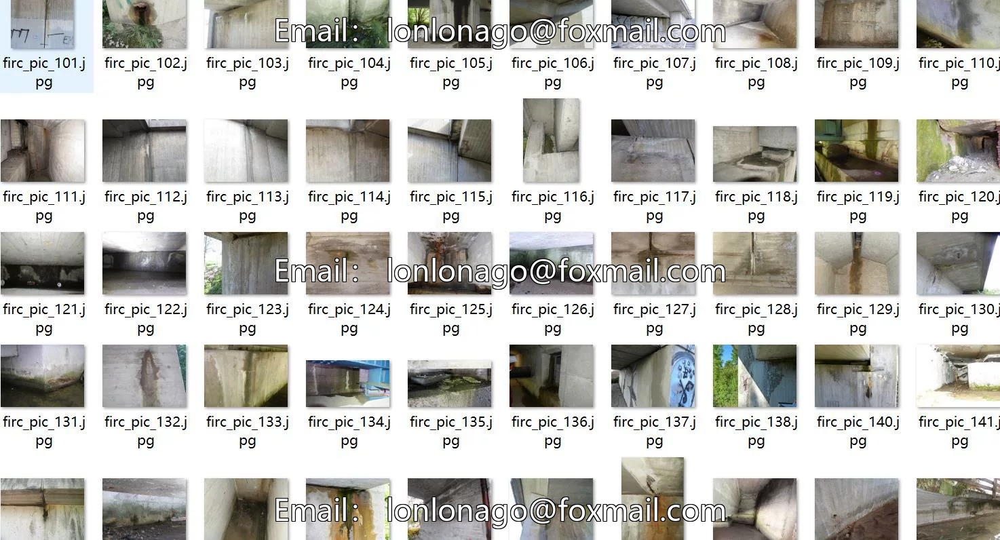
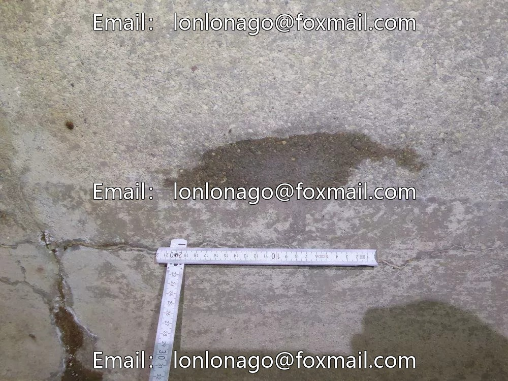
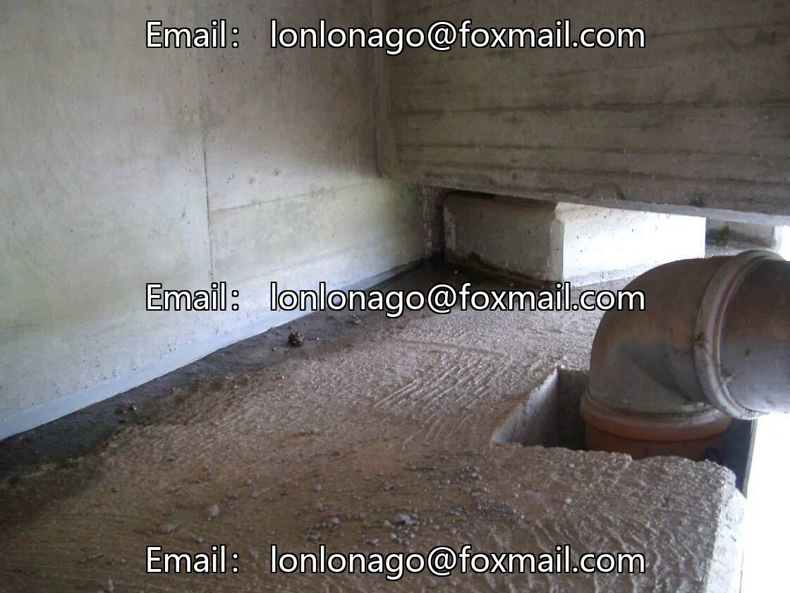
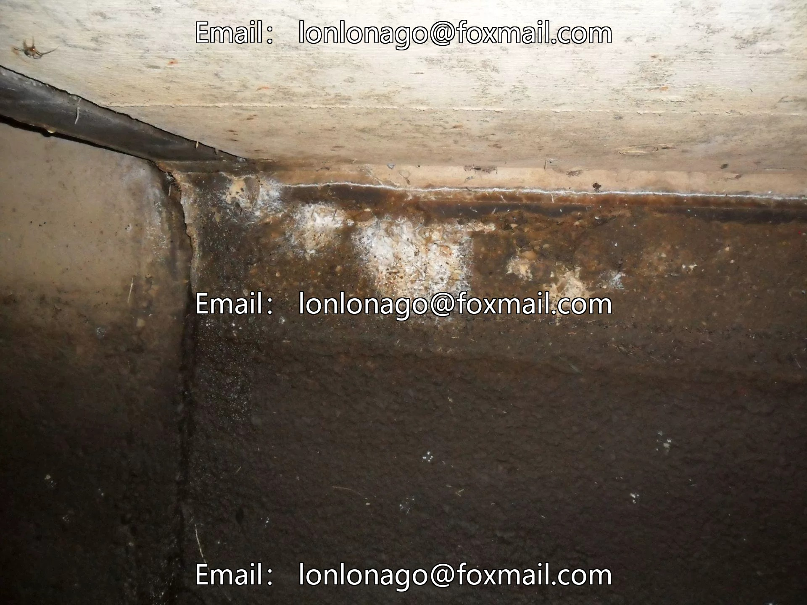

# Bridge rock wall concrete leakage detection dataset VOC+YOLO format with 200 images in 1 class

## Body

Water Leakage Detection Dataset in Pascal VOC+YOLO Format with 200 Images (1 Category)

Precaution: Since the dataset is reproducible, please confirm compliance before purchasing.

Dataset format: Pascal VOC format + YOLO format (txt file without split path, only containing jpg images and corresponding VOC format xml files and yolo format txt files).
Number of images (number of jpg files): 200
Number of annotations (number of xml files): 200
Number of annotations (number of txt files): 200
Number of annotation categories: 1
Annotation category name: ["water_leakage"]

Each category has a specified number of bounding boxes and image coverage.

Water Leakage Frames = 365, occupying images = 200
Total frames: 365
Image resolution: Multi-resolution images such as 1280x720, 1280x960, etc.
Labeling tool used: labelImg
Labeling rules: Draw a rectangle around the category.
Important note: The dataset does not include splitting into training, validation, and test sets; you need to do this yourself.
Special declaration: This dataset does not guarantee the accuracy of the trained models or weight files.

## Images

## Payment

Here is a pay link on Stripe ( https://buy.stripe.com/3cs8yP7sY87d0vu9AB ). Please contact me lonlonago@foxmail.com after funding $89, and I will send you a complete data files , thank you!

